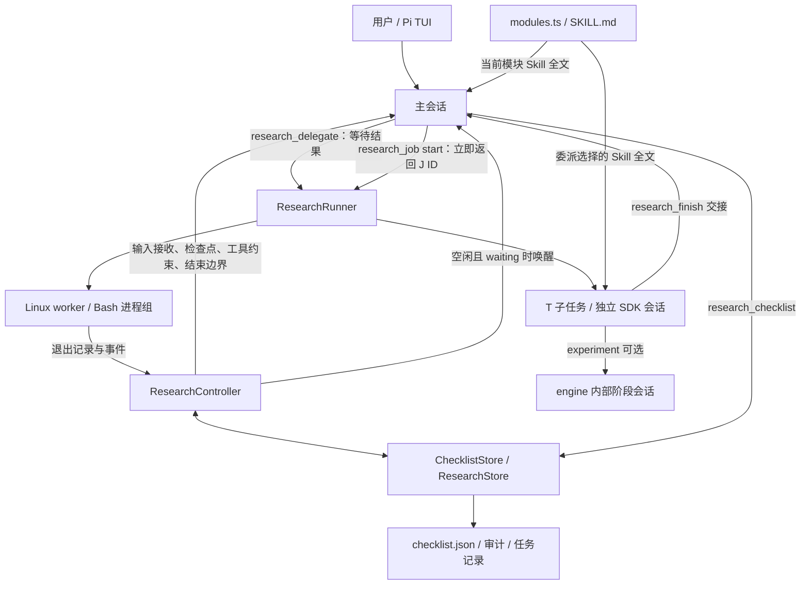

# Researcher 框架理解与维护指南

本文面向使用者和代码维护者，按当前 **0.5.0** 实现解释主会话、清单模块、Skill、子会话、子任务、后台进程和实验 engine 的关系。排查“为什么没有继续”“为什么输入还在排队”“为什么子任务完成却不能验收”时，先确认自己正在查看哪一层状态。

Researcher 的核心是：**主会话根据清单顺序推进研究；Controller 控制输入、请求上下文和结束边界；Runner 执行有界工作；成果交回主会话后，再按模块标准验收。** Skill 提供方法指导，不是独立执行器。只有托管进程 `research_job` 会立即返回，让主会话在工作尚未完成时继续响应用户。

本文依据本仓库源码，描述已有行为，不是未来设计。具体工具 JSON 示例见 [Checklist 调用规范](checklist-protocol.md) 和 [闭环控制与工具协议](closed-loop.md)；参数配置见 [运行配置](configuration.md)。

阅读导航：[概念与架构](#1-先区分七个概念) · [主会话流程](#2-主会话从启动到结束) · [工具与命令](#3-可用工具与命令) · [模块与 Skill](#4-模块如何调用-skill-并按序推进) · [子任务与子会话](#5-t-子任务子会话与-attempt) · [后台进程与唤醒](#6-j-后台进程和时间唤醒) · [实验 engine](#7-experiment-子会话与-engine) · [状态与文件](#8-状态文件预算与审计) · [排障](#9-常见问题排查) · [代码修订入口](#10-修订代码从哪里入手)。

## 1. 先区分七个概念

| 概念 | 身份与生命周期 | 负责什么，以及不代表什么 |
|---|---|---|
| 主会话 | 用户正在操作的 Pi 会话 | 接收用户输入、制定模块、执行轻量工作、委派、核验和综合结论。历史由 Pi 管理。 |
| Controller | 每次加载扩展创建的内存对象；激活时持有项目锁 | 将研究闭环附着于主会话。磁盘上的 `control.state` 不能证明当前仍有活跃 Controller。 |
| 清单模块 | `checklist.json` 中由用户/模型定义的 `id`，如 `M1` | 有目标、Skill 集合、依赖、验收条件和状态。模块是清单记录，不自动创建会话或进程。 |
| Skill | 七个命名的 `SKILL.md` 资源之一 | 方法说明全文进入模型上下文；没有名为 `research-literature` 的可调用模型工具。 |
| 子任务 | `T-<UUID>`，由 `research_delegate` 创建，可有多个 attempt | 一个有界委派的持久化身份，关联目标版本、会话、交接和成果。多个子任务可属于同一模块。 |
| 子会话 | Pi SDK `AgentSession` 和原生 JSONL 会话文件 | 承载子任务的模型对话。新任务不继承父会话历史；续接同一 T 任务打开原会话。默认在同一个 Pi 宿主进程内运行。 |
| 托管后台任务 | `J-<UUID>`，由 `research_job start` 创建 | Linux worker 执行 Bash 进程，保存日志和退出状态。没有模型会话、Skill 加载或 `research_finish`。 |

`engine` 是实验工具：它在一次调用内部再建立分析、计划、执行、评审和总结的 SDK 会话。它不创建新的清单模块，也不自动增加 T 类任务记录。



三个主要职责边界保持不变：Controller 处理事件和生命周期；Store 与清单操作函数管理状态和持久化；Runner 执行子任务、后台进程和取消清理。`modules.ts` 只是资源映射。

## 2. 主会话从启动到结束

### 2.1 加载、初始化和激活不是同一步

[包入口配置](../package.json) 默认只加载 [researcher/index.ts](../extensions/researcher/index.ts)。入口创建 Runner 和 Controller，绑定事件，注册三个主会话工具及 `/researcher`、`/research` 两个等价命令。加载扩展本身不恢复研究。

| 操作 | 实际效果 |
|---|---|
| `/researcher init <目标>` | 创建 `research/BRIEF.md`、`research/STATE.md` 和必要运行目录，保留已有文件；不启动模型，不创建清单。 |
| `/researcher <指令>` | 必要时初始化工作区，然后激活闭环、记录指令，并通过 `sendUserMessage(..., followUp)` 提交消息。 |
| `/researcher resume` | 显式激活闭环并提交恢复消息；已有目标不再次作为新指令入队。尚未初始化工作区时需要先提供目标。 |
| `research_checklist init` | 在已激活闭环中创建结构化清单；后续由 `plan` 定义模块。 |
| 普通用户输入 | 运行中进入共同接收流程；可恢复暂停后可重新激活。其他情况下沿用普通 Pi 行为。 |

激活时，Controller 取得 `.research/controller.lock`，载入未提交的 inbox，建立项目内缓存目录，清除上一轮等待信息，开启新一轮预算。已经激活时再次接收输入不会重置预算。

`checklist.json` 是结构化控制状态的依据；`BRIEF.md` 描述研究目标与约束，`STATE.md` 记录主会话的认识与综合决策。这三个文件不会由框架自动保持文字内容同步。

### 2.2 输入怎样进入研究上下文

命令和普通输入共用 `ResearchController.receive()`，区别在于命令入口需要自行提交消息，普通输入继续由 Pi 原生提交。

```text
用户输入由 Pi 分发到扩展
→ 等待此前取消清理完成
→ 判断是否允许在当前目录激活/恢复
→ 写入待处理指令，持久化 inbox，能提交时进入清单
→ 普通输入由 Pi 原生提交；命令入口调用 sendUserMessage
→ 下一次模型请求前注入最新检查点和当前 Skill
→ 模型处理请求，用 resolve 记录处理结果
→ 结束边界决定完成、暂停、等待或继续
```

这里有三个不同时间点：**TUI 显示输入已排队、扩展记录指令、模型真正发起下一次请求并读取上下文**。看到 `Steering: ...` 不意味着模型已经读到这条消息。当前若在等待一个很长的普通 Bash 调用或 `research_delegate`，主模型通常要等当前工具执行边界结束，才能处理队列中的输入；Researcher 不会把它们自动改成后台调用。

正常记录的输入先进入 `.research/inbox.json`，再追加到 `control.instructions`，获得 `I-...` ID。清单尚未初始化或损坏时，inbox 保留输入，待初始化/修复后再提交。恢复失败时报告原因并阻止该输入进入不受闭环控制的普通模型运行；磁盘写入也失败时会明确报告只能暂存内存。

运行中的提问不重置预算，也不取消 J 类进程，但会撤销旧的一次性等待计划。模型回答后必须 `resolve` 对应指令；仍需要定时检查时重新调用 `research_job wait`。未处理指令阻止整体完成，也阻止进入安静等待。

### 2.3 每次模型请求的上下文

[Controller](../extensions/researcher/controller.ts) 在 `before_agent_start` 追加研究管理提示，在每次 `context` 事件中删除旧的 `research-checkpoint`，注入最新的隐藏检查点。这是**请求级**更新，不只发生在第一条用户消息前。

检查点基于 `checklistState()` 的共享投影：`initialized`、`revision`、`currentModule`、`nextAction`、`pendingInstructions`，以及已有清单的目标版本、模块、简化控制状态和 J 任务摘要。清单工具结果、状态命令也使用此投影。完整审计和已经 resolve 的指令留在文件中，普通返回不重复携带。

主会话额外得到当前模块的 Skill 全文。TUI 的 `research-skills` widget 只显示实际成功读取的名称，例如 `Skills: research-literature`；名称集合不变不重复更新，无 Skill 时不显示，暂停/完成/shutdown 时清除。检查点使用 `display: false`，Skill 正文不放进清单工具返回。这个展示合同不等于禁止模型在普通回答中引用 Skill。

Skill 文件读取失败显示 `SKILL LOAD FAILED` 和明确的资源错误，不把它归类为清单损坏；清单读取失败才提示 `CONTROL REPAIR REQUIRED`。缺失 Skill 需要修复包内资源，`repair` 只能恢复清单。

### 2.4 事件与结束边界

| 事件/函数 | 在主会话中承担的工作 |
|---|---|
| `input` → `receive()` | 统一接收、恢复判断和指令持久化；扩展来源的自动输入不触发恢复。 |
| `agent_start` / `before_agent_start` | 标记主会话忙碌，追加管理提示。 |
| `context` → `checkpoint()` | 在模型请求前刷新清单和 Skill；当前请求消费已观察到的唤醒原因。 |
| `tool_call` | 检查是否可执行当前模块，并检查写入、下载和实验目录等边界。 |
| `agent_before_settle` → `settlement()` | 集中计算结束决定，统一记录状态和续跑次数。 |
| `agent_settled` | 标记空闲、处理 abort、更新状态栏，尝试安排唤醒。 |
| `session_shutdown` → `pause()` | 取消任务和定时器，等待清理，释放锁。 |

结束决定按代码顺序检查：模型异常/中止先暂停；全部模块验收且无待处理输入、无活动工作时完成；超出预算暂停；无待处理指令和待消费事件、且有运行中的 J 任务或显式等待请求时进入 `waiting`；其余情况检查无进展和 blocked 状态，最后才自动继续。

自动继续通过 `agent_before_settle` 的 `continue: true` 和隐藏的 `research-continue` 消息完成。等待则让当前轮真正结束，保持 Controller 激活，不循环调用模型。无进展指纹比较目标版本、模块状态/证据路径/任务 ID、T attempt 和任务状态；修改审计理由、或仅覆盖同一路径的文件内容，不一定改变指纹。

### 2.5 暂停、停止与恢复

| 情况 | 同一运行时、同一目录的普通新输入能否恢复 | 资源处理 |
|---|---|---|
| Escape、`pause`、预算/异常等可恢复暂停 | 能；等待清理完成后开启新一轮预算 | 取消活动 T、J，清除唤醒定时器和 widgets，释放锁。 |
| `stop` 整体停止 | 不能；需要 `/researcher resume` 或显式研究指令 | 同样取消清理。 |
| 研究 `completed` | 不能自动恢复 | 同样清理；成果和审计保留。 |
| 退出或 `/reload` | 不能；新的 Controller 不继承内存恢复标志 | 旧运行时 shutdown；显式启动后读取持久化记录。 |
| `waiting` 时新输入 | 已经处于激活状态，无须重新启动 | 保留 J 进程；撤销旧等待计划，继续处理输入。 |

`/researcher stop T-...` 或 `stop J-...` 只向当前运行时拥有的任务请求取消，不是整体停止。命令提示“取消请求已发送”不等于任务已进入终态；需要再查状态。第三方工具若不响应 AbortSignal，清理可能需要等待它返回。

## 3. 可用工具与命令

### 3.1 主会话的三个 Researcher 工具

| 工具 | 操作与用途 | 执行语义 |
|---|---|---|
| `research_checklist` | `help/read/init/repair/plan/start/update/accept/resolve` | 顺序执行，集中修改清单。`help` 可在未激活时查询，其余操作需要激活。 |
| `research_delegate` | `moduleId, objective, skills, inputs, doneWhen`；续接加 `resumeTaskId` | 注册为可并行执行，但单次调用会等待子任务结束。并行能力不等于后台返回。 |
| `research_job` | `start/status/cancel/wait` | 顺序执行。`start` 立即返回；`status` 查记录/日志尾；`cancel` 等待取消清理；`wait` 登记等待计划。 |

`research_workspace` 已移除；旧 checklist `module` 参数和 `module.id` 回退已移除，使用 `moduleId` 加顶层更新字段。升级后 `/reload` 重新注册工具，再显式恢复研究。

主会话原有 `read/grep/find/ls/write/edit/bash` 以及检索/MCP 工具由宿主 Pi 决定。Researcher 不自动给主会话安装搜索工具或 engine。`/researcher capabilities` 显示主会话实际工具、当前模型和子任务配置预期；“已配置认证”不意味着已经通过在线鉴权。

| 命令 | 主要用途 |
|---|---|
| `/researcher status` | 查看共享清单投影和 T/J 状态摘要。 |
| `/researcher inspect T-...` | 查看任务交接、成果位置等摘要。 |
| `/researcher inspect J-...` | 查看进程状态、退出码和最多 8192 字节日志尾部。 |
| `/researcher capabilities` | 排查模型、工具、子扩展和配置来源；不发起网络验证。 |
| `/researcher help` | 查看命令提示。 |
| `/researcher -- <文本>` | 将 `resume`、`stop` 等保留词作为普通研究指令文本。 |

### 3.2 子会话与 engine 工具集合

| 执行环境 | 默认工具 |
|---|---|
| 普通 T 子任务 | `read, grep, find, ls, write, edit, bash`，配置的 `extraTools`，以及 `research_finish`。 |
| 纯 `research-review` 子任务 | `read, grep, find, ls`，配置的 `reviewerTools`，以及 `research_finish`。 |
| 含 `research-experiment` 的 T 子任务 | 在上述集合上添加 `engine_start, engine_status, engine_abort`，自动加载本包 engine 扩展。 |
| engine 分析/计划/评审/总结阶段 | `read, grep, find, ls`。 |
| engine 执行阶段 | 上述读取工具加 `write, edit, bash`。 |

混合 `research-review` 与其他 Skill 的任务采用普通可写集合；需要独立只读评审时，应单独委派纯 review 任务。默认子会话没有 `research_checklist`、`research_delegate`、`research_job`，不能操作主清单或自由递归委派。配置也拒绝这些通用控制工具。

`childExtensions` 决定加载哪些实现，`extraTools/reviewerTools` 决定哪些工具实际开放。SDK 加载后核对所需工具，再设置精确活跃集合。主会话有某个搜索工具，不代表子会话自动拥有它。

## 4. 模块如何调用 Skill 并按序推进

七个 Skill 是 `research-task`、`research-literature`、`research-hypothesis`、`research-method`、`research-experiment`、`research-report`、`research-review`。它们不是固定七阶段流水线：模块由 `plan` 动态定义，可以组合 Skill、重复使用 Skill，也可没有 Skill。委派要求至少一个 Skill，因此无 Skill 模块应直接执行或先调整定义。

选择规则在 [checklist.ts](../extensions/researcher/checklist.ts) 的 `currentModule()`：取数组中第一个未跳过、且未按当前 `objectiveRevision` 验收完成的模块。依赖必须排在该模块之前；即使两个模块没有依赖，也不能越过数组中的当前模块执行。

常见路径是：`pending → start → running → 收集证据 → awaiting_acceptance → accept → completed`。其中 `awaiting_acceptance` 可以由 update 或委派返回设置；直接执行的模块也可以从 running 直接 accept。`blocked` 需要解决后重新启动，或通过 update 给出理由显式 skipped；它不会自动被选择器略过。

| 清单动作 | 维护时必须保留的约束 |
|---|---|
| `plan` | 提交完整有序模块定义，保留已有 ID；有活动 T/J 时拒绝重规划。定义变化或顺序变化会重开该位置及后续模块，保留历史证据、交接和任务关联。 |
| `start/update/accept` | 只能针对当前模块；update 只更改提供的字段，不能以 `status: completed` 绕过 accept。 |
| `accept` | 必须先启动；每条 criterion 有一条非空说明，至少一个证据且文件存在或为 HTTP(S) URL，当前模块无活动 T/J。验收记录 `acceptedRevision`。 |
| `resolve` | 用 `instructionId` 找到用户指令，`reason` 记录如何处理。改变全局 objective 时需先结束/取消全部活动工作，再增加目标版本并重开所有模块，保留旧证据。 |
| `repair` | 恢复已提交快照并保存被拒绝的原始内容；不用于解决普通 revision 冲突。 |

除 `help/read/init/repair` 外，修改要求 `expectedRevision` 和非空 `reason`。每次读取结果后再做一个修改；用户输入、任务事件也可能增加 revision。冲突时重新 read，不能猜 revision 或回退文件。

当前模块未启动时，只允许读取和清单管理等入口；J 的状态/取消/等待管理有专门例外。委派的 Skill 集合必须与当前模块一致。主会话每次请求加载其全文，子会话启动时也加载对应全文。主模块声明 experiment 只影响主检查点及入口检查，**不会自动注册主会话的 engine 工具**。

完成条件分层判断：J 的 `succeeded` 只表示命令成功退出；T 的 `completed` 只表示提交有效结构的完成交接；模块 `completed` 表示通过该版本的清单验收；整个研究完成还要求所有模块已验收或有理由跳过、无待处理指令、无活动 T/J。HTTP(S) 证据只做格式层面的认可，不自动下载核实内容，科研正确性仍需主会话和评审判断。

## 5. T 子任务、子会话与 attempt

### 5.1 一次委派的完整路径

1. `index.ts` 检查闭环已激活、模块为当前模块且已启动、Skill 集合匹配；将模块标记 running。
2. `ResearchRunner.run()` 核对工作区、模型、研究/目标版本、并发配额和续接条件，取得 T 任务锁。
3. 创建本次 attempt 记录和专属输出目录。`BRIEF.md`、`STATE.md` 自动加入输入路径列表，其他 inputs 也必须是项目内已有文件。
4. `runSdk()` 创建新子会话，或打开保存的确切 JSONL 会话；加载选定 Skill 全文、显式扩展和精确工具集合。
5. 子会话按输入路径自行读取资料，在分配目录工作，通过 `research_finish` 提交结构化交接。
6. Runner 保存终态、使用量、attempt 记录和 `handoff.md`，释放任务锁并返回。主会话随后读取证据、验收模块或处理失败。

子会话继承主会话选定的模型和 thinking 设置，模型连接通过宿主 registry 转发，包括已经配置的自定义 provider；它不复制父会话全部历史或假定认证必须来自某个环境变量。提示中包含委派目标、完成条件、清单目标版本和当前模块，以及文件输入/输出位置。

`research_finish` 接收 `status: completed | partial | blocked`、摘要、成果、证据、未决问题和下一步。成果文件必须存在于**当前 attempt** 输出目录，交接后终止该子任务的模型执行。纯 review 可以通过交接文本报告评审，由 Runner 保存文件。没有这个结构化交接而普通结束的任务记为 partial，即便自然语言声称已经完成。

执行异常通常由 Runner 转为 failed/cancelled/timed_out 记录再返回。因此 **模块 awaiting_acceptance 不保证子任务成功**：`index.ts` 在拿到 TaskRecord 后会统一设置该模块状态；只有 Runner 直接抛出的启动等异常走 blocked 分支。排障时同时检查 `task.status`、交接、工具 `isError` 和真实成果。

### 5.2 续接关系

```text
模块 M1
├── T-a：同一份子会话 JSONL
│   ├── attempt-1：第一次执行和独立成果目录
│   └── attempt-2：resumeTaskId=T-a，延续原会话，使用新成果目录
└── T-b：另一份新子会话 JSONL，可通过 inputs 引用 T-a 的成果
```

续接必须使用确切 T ID、现存项目内会话文件、相同 provider/model、配置摘要和 Skill 数组；不能借续接切换所属模块。模块匹配比较 Skill 集合，续接比较原数组，因此续接时也应保持 Skill 顺序。配置或模型改变时，创建新任务并用文件关联旧成果。

每次 attempt 都保留新记录；恢复会话不会回滚磁盘，Pi 的会话树也不是实验代码回滚工具。Runner 记录开始时的 `BRIEF.md` 摘要；运行期间该文件变化会设置 `staleBrief`，原 completed 降为 partial。通过清单协议改变全局目标则会先要求结束活动任务，两种机制不要混淆。

模块 `taskIds` 中的 T ID 在委派返回后追加，J ID 在启动时追加。查“是否有活动工作”应使用 `ResearchStore.activeWork()`/状态命令，不能只凭模块当前 `taskIds` 判断。

## 6. J 后台进程和时间唤醒

### 6.1 下载期间为什么可以回答用户

适合长下载的流程是：启动当前模块 → `research_job start` → 获得 J ID → 必要时登记 `wait` → 结束当前回答。下载在 worker 内前台执行，主会话此时已没有未完成的下载工具调用。

例如当前 M1 已启动后，模型可调用：

```json
{
  "action": "start",
  "moduleId": "M1",
  "command": "python3 -u -c 'from moabb.datasets import BNCI2014_001; BNCI2014_001().download()'",
  "env": {"MNE_DATA": "/home/chenl/project/temp/workspace/eeg-test/mne_data"},
  "timeoutSeconds": 1200
}
```

路径必须属于实际研究根目录；这里沿用 EEG 项目的示例路径。需要一分钟后检查时再调用：

```json
{"action":"wait","wakeAfterSeconds":60}
```

`wait` 返回登记结果，不会在工具内部 sleep，也不会强制结束模型当前轮；模型还需结束回答，Controller 才能在结束边界进入 waiting。有运行中的 J 时，即使未调用 wait，满足条件也会自然等待进程完成。只有计时、没有运行中 J 的等待也允许；既无 J 又无时间的 wait 会报错。

用户此时问“一共要下载多少数据”，主会话可读取已有日志/元数据、回答并 resolve，下载继续。框架不会自动计算数据总量：J widget 只有任务 ID、running 状态和已用时间；日志尾也可能因程序缓冲暂时为空。是否能给出准确总量取决于程序输出和数据集元信息。

### 6.2 worker 的管理边界

Runner 校验当前模块、工作目录、超时和环境变量，写入 J 记录，通过 IPC 启动 [process-worker.mjs](../extensions/researcher/process-worker.mjs)。worker 把 Bash 放在独立进程组，stdout/stderr 写入 `output.log`，最后原子写入 `exit.json`。

完全相同的活动命令请求按指纹去重；已终止的任务再次执行会产生新 J ID，不自动续跑失败下载。指纹包含研究/目标版本、模块、命令、cwd、env 和超时，并非 shell 语义等价比较。

`cwd` 和 `MNE_DATA` 必须位于研究根内；未指定 `MNE_DATA` 时默认根下 `mne_data`。`TMPDIR`、`XDG_CACHE_HOME` 由框架设置到 `.research/`，env 值不写入 job.json（只记变量名）。普通 Bash 不会自动获得 J 的 MNE_DATA 默认值。命令文本和程序日志仍会被保存，不能把秘密值直接写进命令或让程序打印出来。

命令应保持在 worker 前台，不使用 `nohup`、末尾 `&` 或自行 daemonize。这是使用合同，没有 shell 语义分析器来机械禁止所有脱离方式。取消先向进程组发 SIGTERM，约 500ms 后强制 SIGKILL；正常退出也清理剩余组内进程。宿主失联触发 worker 的 IPC 断开清理。worker 自己的退出码不等于科研命令退出码，应查看 `exit.json`/J 状态。

### 6.3 何时唤醒，何时不会唤醒

Runner 的完成回调和 Controller 每 2 秒的本地状态检查发现 J 终态变化，记录审计、积累唤醒原因。这个检查不调用模型。时间到达或有终态事件后，只有在 **Controller 激活、waiting、主会话不忙、Pi 空闲且没有排队消息** 时，才发送隐藏 `research-wake` 并触发新一轮。

同一等待周期的计时与进程事件合并，避免重复触发；主会话正在处理输入时不往其后偷偷追加自动消息。下一次请求总会看到最新检查点。用户输入撤销旧定时计划；pause/stop/shutdown 清除所有计时器，并用 generation 检查使旧回调失效。

这不是跨会话定时服务：`wakeAt` 虽然可见于持久化控制状态，运行时的 timer 不会在退出/reload 后重建，J 也不承诺继续存活。显式恢复先检查终态和产物，再决定是否重新启动作业。

## 7. experiment 子会话与 engine

[engine/index.ts](../extensions/engine/index.ts) 的 `EngineCore.start()` 接收含 `method.md` 的项目目录；含 experiment Skill 的 T 子会话自动拥有三个 engine 工具。主会话若需要直接使用 engine，必须额外加载它；Researcher 激活时还要求当前模块声明 `research-experiment`。

```text
主会话等待 research_delegate
  → experiment 子会话等待 engine_start
    → analyze（只读）→ plan（只读）
    → 每个 step：execute（可写）→ review（只读），按限额重试
    → summarize（只读）→ 运行器写 results.md
  → 子会话核对结果并 research_finish
→ 主会话核对交接并 accept 模块
```

每个 engine 阶段使用独立 SDK 会话，不复制 experiment 子会话的完整对话。阶段没有自由委派工具；取消向下传播，内部阶段受自身请求上限以及 engine/外层 T 总时间限制。一次 engine_start 也会前台等待，J 后台机制不会自动进入子会话或 engine。

engine 在 `<projectPath>/experiments/` 保存 `CONTEXT.md`、`plan.json`、`progress.json`、`results.md`、阶段 sessions 和 `runs/<调用ID>/<序号>-<阶段>/` 下的请求、响应及运行记录。恢复沿用原计划、跳过已完成步骤；`method.md` 摘要改变会拒绝继续原实验目录，以免混用结果。

T 续接可明确指向同一 T 下旧 attempt 的实验目录；新的 T 不能直接把另一个 T 的实验目录作为自己的 engine 工作区。engine completed、子任务 completed、模块 accepted 是三次不同的判断，任何内层成功都不会自动通过外层验收。详见 [engine 接入与迁移](engine.md)。

## 8. 状态、文件、预算与审计

### 8.1 状态分别属于谁

| 层级 | 状态 |
|---|---|
| 主控制 `control.state` | `running / waiting / paused / stopped / completed`；另有仅在内存中的 active、busy、pausing 等标志。 |
| 模块 | `pending / running / awaiting_acceptance / completed / blocked / skipped`。 |
| T 子任务 | `running / completed / partial / blocked / failed / cancelled / timed_out / interrupted`。 |
| J 后台进程 | `running / succeeded / failed / cancelled / timed_out / interrupted`。 |
| engine | 初始化、planning、executing、reviewing、summarizing 等阶段，以及 completed/failed/aborted/timed_out 终态。 |

宿主意外死亡后，查询函数可能依据 owner 或 worker 身份把磁盘上仍为 running 的记录**投影为 interrupted**；不意味着原始 JSON 已被重写。J 查询优先读取 exit.json，并核对 Linux PID 的进程出生标识，避免把复用 PID 当成原 worker。不能根据旧文件中的 PID 直接杀进程。

### 8.2 文件位置与追踪顺序

```text
研究根目录/
├── checklist.json                    # 当前已提交控制状态、完整 audit
├── .pi/research.json                  # 项目运行配置
├── research/
│   ├── BRIEF.md / STATE.md            # 目标说明 / 主会话综合
│   └── evidence|experiments|reviews|notes/
│       └── T-.../attempt-N/           # 子任务成果、handoff.md、可选 assistant-output.md
└── .research/
    ├── controller.lock               # 活跃研究 Controller 的 owner 锁
    ├── inbox.json                    # 尚未提交到清单的用户输入
    ├── checklist/
    │   ├── revision-N.json            # 各次提交
    │   ├── latest.json                # 修复的提交点
    │   └── rejected-<UUID>.json        # repair 保留的外部改动
    ├── tasks/T-.../
    │   ├── task.json / attempt-N.json # 最新任务状态 / attempt 记录
    │   └── owner.lock                 # 运行期间的续接锁
    ├── sessions/                     # T 子会话原生 JSONL
    ├── jobs/J-.../
    │   └── job.json / output.log / exit.json
    └── downloads/ / cache/ / tmp/
```

排查时依次关联 `researchId → objectiveRevision → moduleId → T/J ID → attempt/sessionFile 或 logPath`。主会话原生会话由宿主 Pi 保存，不在这棵 T 子会话目录树内；engine 阶段会话位于其单独实验目录。主控制审计、T 会话、J 日志分别回答“为什么推进”“模型做了什么”“程序运行了什么”。

清单提交顺序为 revision 快照 → latest → 根 checklist，写文件使用临时文件加原子 rename。读取要求根文件与 latest 内容一致；即使只是手改格式也会触发协议外修改错误。repair 保存 rejected 内容并从 latest 创建新修订；不存在已提交快照时不会直接覆盖未知清单。

### 8.3 不同预算不要混用

| 限额 | 当前默认值与入口 | 含义 |
|---|---|---|
| 主闭环时间 | 30 分钟；`controller.ts` | 包含 waiting 时间；恢复开启新一轮，运行中输入不重置。 |
| 主自动续跑 | 20 次；`controller.ts` | 普通自动继续和真实自动唤醒共用；不等于模型请求数。 |
| 无进展 | 指纹连续重复计数达到 3；`controller.ts` | 触发暂停；单纯等待不累积此计数。 |
| 活动工作数 | `maxConcurrent: 2`，范围 1–8 | 同一项目运行中的 T 和 J 合计，读取任务记录计算；不是 GPU 调度器或通用跨进程原子配额。 |
| T 超时/请求 | `timeoutMs: 900000`、`maxTurns: 30` | 每次 attempt；请求数包含该会话的压缩请求。 |
| J 超时 | `timeoutSeconds: 1200`，范围 1–86400 | 单个进程；仍受主闭环剩余时间制约。 |
| 一次时间唤醒 | `wakeAfterSeconds: 1–1800` | 一次性，不是周期定时器；不会延长闭环截止时间。 |
| engine | 默认 15 分钟、最多 12 步、每步最多 2 次重试 | 只读阶段最多 20 次模型请求，可写阶段 40 次；受外层委派时间限制。 |

前面三项是 Controller 中的常量，不是 `.pi/research.json` 已支持的配置项。token/费用从 SDK 会话使用量聚合返回，engine 嵌套使用量经工具传回；预算次数与费用统计不是同一个量。

## 9. 常见问题排查

| 现象 | 先看什么 | 处理方向 |
|---|---|---|
| 输入一直显示 Steering/queued | 当前工具是普通 Bash、delegate、engine_start，还是已返回的 J start | 长前台工具尚未结束就没有下一次主模型请求；今后的长进程改用 J。后台启动后也需让模型结束当前回答。 |
| 没继续执行，也没报错 | `control.state`、活动 J、`wakeAt`、未处理指令 | waiting 是有意不调用模型；核实是否有作业/定时事件，或发送新输入。 |
| pause 后输入不能恢复 | 提示中的具体错误、目录、模型、controller.lock、inbox | 先消除模型缺失或其他 owner 等原因；恢复失败的指令已尽力保留。reload/stop 后显式 resume。 |
| “未初始化/先启动当前模块” | `research_checklist read` 的 `initialized/currentModule/nextAction` | 工作区 init 不等于清单 init；按 init → plan → start 推进，不绕过工具检查。 |
| Revision conflict | 最新结果、是否刚有输入/任务事件提交 | read 后用最新 revision 重试一个修改，不用 repair。 |
| CONTROL REPAIR REQUIRED | 根清单与 `.research/checklist/latest.json` | 通过 repair 恢复，再把需要的修改通过协议重做；查看 rejected 文件。 |
| Skill 加载错误或 widget 缺名称 | 错误的 Skill 名称、包内对应 SKILL.md | 恢复缺失资源/权限；不是清单损坏。widget 只展示成功读取的 Skill。 |
| 子会话缺少搜索工具 | capabilities 的子扩展/工具配置，子会话启动错误 | 实现路径和工具白名单都要配置；主会话加载成功不能证明子会话已加载。 |
| 子任务返回后模块 awaiting_acceptance，但结果失败 | T 状态、isError、handoff.md、sessionFile | 该模块状态只代表需要主会话处理返回记录；不可据此验收。 |
| 不能 accept、skip、plan 或改目标 | 活动 T/J 记录 | 等待或取消相关工作并确认终态。plan/改目标检查全部活动工作，accept/skip 检查当前模块。 |
| J 日志为空、没有下载百分比 | output.log、程序缓冲、实际文件大小 | 对 Python 可用 `-u`；框架仅保存输出，不推断下载总量或百分比。 |
| 任务完成但没有立刻唤醒 | 是否仍 waiting、主会话是否忙/有队列、是否已到预算 | 唤醒不会抢占活跃用户轮；检查下一次 checkpoint 和 audit，避免手工反复触发模型。 |
| reload 后定时任务没继续 | 旧 J 终态、已有文件、显式激活状态 | 计时器不跨 reload；检查部分产物后按需新建 J，不宣称自动断点恢复。 |
| 续接失败 | 模型、配置摘要、Skill 顺序、会话文件、所属模块 | 保持原条件续接，或新建 T 并引用旧成果。不要删除活 owner 的锁强行续接。 |
| engine 恢复失败 | method 摘要、plan/progress、同一 T 的实验路径 | 方法改变用新实验目录；保持旧证据，不能把重跑成功当作旧结果已被修复。 |
| 仅更新文字仍被判无进展 | fingerprint 实际包含的字段 | 用有意义的状态、证据和任务进展记录推进；不要靠修改 audit 理由保活。 |

代码强制的是清单转换、顺序、委派匹配、工具入口及部分路径边界。通用 Bash、第三方工具和 Skill 的科研语义仍依赖模型遵守约定与验收；目录约束不是操作系统沙箱，也不能机械证明 Skill 已被正确执行。

## 10. 修订代码从哪里入手

| 想改变的行为 | 主要代码入口 | 应同步验证的合同 |
|---|---|---|
| 命令、委派参数和交接后模块状态 | [index.ts](../extensions/researcher/index.ts) | 命令与普通输入共用接收；真实注册工具集合；失败记录不得被误当验收通过。 |
| 输入恢复、请求检查点、Skill widget、等待/唤醒 | [controller.ts](../extensions/researcher/controller.ts) | 每次请求刷新；恢复失败保留输入；运行中输入不重置预算；旧计时器不能在 stop 后复活。 |
| 当前模块、完成条件、共享状态投影、审计 | [checklist.ts](../extensions/researcher/checklist.ts) | 数组顺序、目标版本验收、未处理指令/活动任务阻止完成、快照一致性。 |
| checklist schema/局部更新/错误恢复提示 | [checklist-tool.ts](../extensions/researcher/checklist-tool.ts) | schema、描述、示例和运行时验证一致；旧 module 参数拒绝；revision 冲突不走 repair。 |
| J 参数和模型使用提示 | [job-tool.ts](../extensions/researcher/job-tool.ts) | start 快速返回，wait 是登记而非阻塞；保持前台命令使用合同。 |
| T 续接、交接、J 启动/停止和使用量 | [runner.ts](../extensions/researcher/runner.ts) | T/J 共享配额、精确续接、当前 attempt 成果、真实终态、取消等待完成。 |
| Linux 进程组、IPC、超时和退出日志 | [process-worker.mjs](../extensions/researcher/process-worker.mjs) | 取消后后代退出、宿主失联清理、exit.json 可信、不得误杀复用 PID。 |
| SDK 会话、provider 转发、工具/Skill 装配 | [sdk.ts](../extensions/researcher/sdk.ts) | 不复制父历史；选定模型连接可用；精确工具集合；请求上限和 dispose。 |
| 持久化、路径、锁、配置、状态查询 | [store.ts](../extensions/researcher/store.ts) | symlink/越界校验、owner token、死亡 owner 恢复、J 身份校验、记录兼容。 |
| Skill 与 engine 资源映射 | [modules.ts](../extensions/researcher/modules.ts)、[skills/](../skills/) | 主/子会话读相同 Skill；主会话不因映射自动注册 engine；widget 不泄露资源全文。 |
| Bash 工作目录和缓存 | [boundaries.ts](../extensions/researcher/boundaries.ts) | 明确协作边界，不把命令前缀描述为强隔离。 |
| engine 阶段、恢复、评审与产物 | [engine/index.ts](../extensions/engine/index.ts) | 保留计划和已完成步骤、方法摘要校验、取消传播、阶段产物和真实终态。 |

已有回归入口包括 `tests/checklist-protocol.test.ts`（工具协议、Skill 展示、输入和预算）、`tests/researcher.test.ts`（状态、Runner、真实 SDK 闭环）、`tests/background-jobs.test.ts`（进程、等待、唤醒、取消、PID 身份），以及 `tests/tui-smoke.py` / `tests/fixtures/tui-provider.ts`（真实 Pi 终端中的离线确定性验证）。

修订运行行为后执行 `npm run check`；修改发布文件或入口时执行 `npm run pack:check`；修改输入、widget 或唤醒生命周期时再执行 `npm run test:tui`。这些验证使用本地确定性 provider，不调用付费模型。在线 provider 的实际连通性和研究质量需另行验证，不能用离线通过代替。详细范围和既有结果见 [验证说明](validation.md)。
